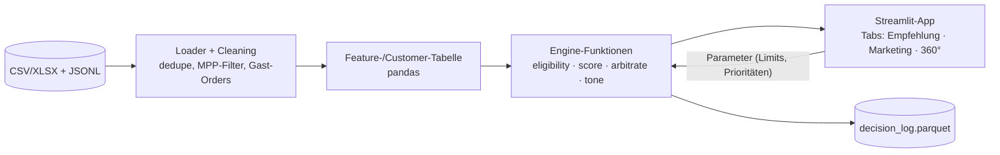
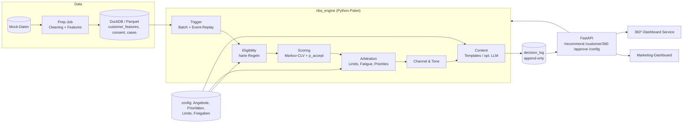
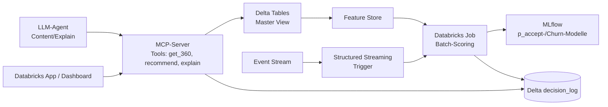

# Planung: MAINGAU Next-Best-Action-Engine
Futury Build Days #3 (AI Edition), 26.–27.10.2026

**Quellen:** `Hackathon_slides_for_MAINGAU.pptx` (13 Folien, inkl. Sprechernotizen). Belege stehen als **[Fn]** für Folie n. Mit **[Fn-N]** ist die Sprechernotiz von Folie n gemeint. Ergänzend habe ich die mitgelieferten Mock-Daten gesichtet (`Re__Präsentation_Hackathon/…`). Aussagen daraus sind als **[Daten: Datei]** gekennzeichnet. Sie sind nicht Teil der Präsentation, sie präzisieren sie nur.

**Bildinhalte:** Ich habe alle eingebetteten Bilder angesehen. Es sind das MAINGAU-Logo (F1, F13), ein Bürofoto (F3) und Icons der Geschäftsfelder (F4). In keinem Bild steckt Aufgabeninhalt. Diagramme wie die Pipeline (F9) und die Systemlandschaft (F5) bestehen aus PowerPoint-Formen mit Text und sind vollständig über den Folientext erfasst.

---

## 1. Aufgabenstellung

### 1.1 Ziel und Problem in eigenen Worten

MAINGAU hat fünf Geschäftsfelder, und jedes hat sein eigenes System: Energie, Autostrom, Mobilfunk, Online-Shop und Smart Living [F4, F5]. Eine einheitliche Kundensicht auf Databricks ist im Aufbau. Es fehlt aber die **Entscheidungsschicht** darüber, die festlegt, welches Angebot über welchen Kanal, in welcher Tonalität und zu welchem Zeitpunkt kommt [F5].

Heute laufen Kampagnen über grobe, produktbezogene Segmente mit statischen Kriterien. Sie sind weder personalisiert noch dynamisch und blenden den Customer Lifetime Value (CLV) aus [F6]. Die größte Lücke ist das Cross-Selling über das Portfolio hinweg [F6-N].

**Ziel:** ein klickbarer Prototyp, der pro Kunde **Angebot, Kanal und Tonalität** empfiehlt, dazu ein Marketing-Dashboard zur Steuerung [F6]. Als „beste“ Aktion gilt die mit dem **höchsten erwarteten CLV-Zuwachs** [F6, F7]:

> E[Wert einer Aktion] = p(accept) × (CLV_nachher − CLV_jetzt) − Kontaktkosten [F7]

Der Kern ist also kein klassisches Empfehlungssystem („was passt zum Kunden“), sondern eine **wertbasierte Entscheidung unter Nebenbedingungen**. Dazu gehören Consent, Ausschlüsse, Kontaktlimits und Human-in-the-Loop [F8, F12]. Jede Entscheidung muss erklärbar und geloggt sein [F8, F12]. Oft ist eine **Service-Aktion** besser als ein Verkaufsangebot [F7].

### 1.2 Anforderungen

**MUSS** (Kern, für jedes Team gleich [F11, F11-N])

| # | Anforderung | Beleg |
|---|---|---|
| M1 | Klickbarer Prototyp: pro Kunde Angebot, Kanal, Tonalität (Du/Sie), erwarteter CLV-Gewinn und Begründung | F8, F10, F11 |
| M2 | Ranking nach erwartetem CLV-Gewinn. Negative Aktionen fallen weg, Fatigue und Limits werden beachtet | F7, F9 |
| M3 | Marketing-Dashboard: Top-NBAs über Kunden und Segmente hinweg. Angebote, Prioritäten und Kontaktlimits einstellbar. Inhalte, Kanäle und Tonalität freigeben | F10, F11 |
| M4 | Customer-360°-Dashboard für Service: Status (Produkte, Verträge, offene Fälle), CLV, bestgerankte NBAs mit Begründung | F10, F10-N, F11 |
| M5 | Architekturkonzept auf **einer** Folie: Betrieb auf Databricks mit MCP-Datenzugriff | F10, F11 |
| M6 | Pitch: 8 Min. plus 4 Min. Q&A, **auf Englisch** | F11, F12 |
| M7 | **Eine** Deep-Dive-Option aus A–D | F11 |
| M8 | **Explain:** Ein Marketer versteht in einer Zeile, warum die Aktion gewählt wurde, und kann sie ändern | F8 |
| M9 | **Learn als Konzept:** Wie verbessern Reaktionen die Engine, und wie wird Kausalität belegt (Kontrollgruppe, Uplift)? | F8, F8-N |
| M10 | Harte Regeln, die **vor** dem Ranking greifen: Consent ist bindend, und ein Widerruf stoppt sofort. Ausschlüsse (Mahnung, offene Beschwerde, Kündigung) sperren Sales-Inhalte | F7-N, F12 |
| M11 | Kein autonomes Versenden: Die Engine schlägt vor, das Marketing gibt frei | F12 |
| M12 | Personalisierung nur mit Profiling-Consent | F12 |
| M13 | Keine Manipulation: keine personalisierten Preise, keine künstliche Dringlichkeit, kein Targeting von Kunden in Notlagen | F12 |
| M14 | Zahlungsdaten nur als Ausschlusskriterium, nie zur Bonitätsbewertung | F12, F12-N |
| M15 | Logging jeder Entscheidung mit Inputs, Regeln, Scores und gewählter Aktion | F8, F12 |
| M16 | Nur Mock-Daten, kein Scraping von MAINGAU-Systemen. Kundeninhalte auf Deutsch | F12 |

**SOLL** (empfohlen, verbessert die Bewertung)

| # | Anforderung | Beleg |
|---|---|---|
| S1 | Referenz-Pipeline übernehmen: Trigger → Eligibility → Scoring → Arbitration → Channel & Tone → Content → Delivery & Log. Abwandlungen sind erlaubt | F9, F9-N |
| S2 | Start mit Regeln, vorberechnetem CLV und Annahmeraten aus der Action History | F9 |
| S3 | Kontrollgruppe führen und beibehalten | F8, F9 |
| S4 | Die vier Beispielfälle abdecken: Gaszähler-Abmeldung → Wärmepumpenstrom, Wallbox-Kauf → Autostrom, dreimal Klick auf Wärmepumpen-Story → Follow-up, High-Value- vs. Neukunde | F6 |
| S5 | Das Autostrom-Beispiel korrekt lösen: Bei 3 fehlgeschlagenen Ladevorgängen bekommt der Service-Fix einen positiven Score, das Stromangebot einen negativen | F7 |
| S6 | Kanalwahl nach Verhalten: Ein formal schreibender Kunde, der nie Newsletter öffnet, aber wöchentlich im Portal ist, bekommt ein Portal-Pop-up mit „Sie“ | F9 |
| S7 | Pfad zu ML skizzieren | F9-N |

**KANN** (optional)

| # | Option | Beleg |
|---|---|---|
| K1 | ML-Modelle (p_accept, Churn, Tonalität). „ML is optional“ | F9 |
| K2 | Content-Generierung per LLM innerhalb freigegebener Templates (entspricht Deep Dive C) | F9, F11 |
| K3 | Event-Replay der 640 Live-Events (entspricht Deep Dive B). Kein Live-Event-Processing im Kern | F6-N, F11, F12 |
| K4 | Feedback-Loop und Uplift tatsächlich bauen (Deep Dive A) | F8-N, F11 |
| K5 | Tonalitätserkennung als eigenes Modell (Deep Dive D) | F11 |

**Explizit nicht gefordert:** Datenintegration, also „the pipes“ [F5, F5-N], Live-Event-Processing im Kern [F6-N] und produktive Schnittstellen [F6-N].

### 1.3 Vorgegebene Daten, Schnittstellen, Technologien, Abgabeformate

- **Daten:** 750 synthetische Kunden, 16 Tabellen mit einem gemeinsamen `customer_id`, 640 Live-Events zum Replay, 10 % Kontrollgruppe in der Action History [F12]. CLV, Margen, Churn-Treiber und alle Parameter sind vorberechnet (`customer_value`, `value_assumptions`) [F7].
  - [Daten: README] Snapshot vom 30.09.2026 23:59, Event-Stream vom 01.10.2026. 150 Kunden haben nur Autostrom. Die Daten enthalten absichtliche Fallen: Apple-MPP-Maschinenöffnungen, verspätete Roaming-CDRs, Gastbestellungen, Consent-Widerruf per Unsubscribe, Altaktionen ohne Consent-Check, offline HEMS-Gateways und doppelte Events (bestätigt in F12-N).
  - [Daten: clv_method] Die genaue dCLV-Formel inklusive Ablehnungszweig (siehe Abschnitt 3) und Hinweisen zu Einmalprodukten.
- **Technologie-Zielbild:** Databricks (Master View) und MCP für den Datenzugriff, aber nur als Architekturkonzept [F5, F5-N, F10]. LLM für Content ist eine Möglichkeit, keine Pflicht [F9].
- **Schnittstellen:** Es gibt keine Live-Schnittstellen, die Daten liegen als Dateien vor [F5, F6-N]. [Daten] Vorhanden sind XLSX, CSV und JSONL.
- **Abgabe:** Prototyp, Marketing-Dashboard, 360°-Dashboard, eine Architekturfolie, Pitch (8 + 4 Min., Englisch) und ein Deep Dive [F11].
- **Zeitbudget:** 32 Stunden [F6-N].

---

## 2. Bewertungskriterien

### 2.1 Jury-Gewichtung [F11]

| Kriterium | Gewicht |
|---|---|
| Technical quality | 25 % |
| Feasibility | 25 % |
| Impact for MAINGAU | 25 % |
| Innovation | 15 % |
| Pitch | 10 % |

**Prüfung an Referenzkunden, die in den Daten versteckt sind** [F11]:
1. Erwarteter CLV-Gewinn der empfohlenen Aktionen
2. **Null** Consent- oder Ausschlussverletzungen
3. Eine klare Begründung für jede Entscheidung

### 2.2 Konsequenzen für die Priorisierung

1. **Korrektheit vor Raffinesse.** Eine einzige Consent- oder Ausschlussverletzung bei einem Referenzkunden ist ein harter Fehler, weil die Vorgabe „zero“ lautet. Die Eligibility-Stufe ist deshalb die wichtigste Komponente. Sie braucht Unit-Tests gegen jede bekannte Datenfalle, darunter Unsubscribe als Widerruf, Altaktionen mit `consent_checked=False` und Mahnstufen.
2. **Die dCLV-Rechnung muss exakt der Vorgabe in `clv_method` folgen.** Die Jury rechnet den „expected CLV gain“ sehr wahrscheinlich nach dieser Methode nach. Eigene „bessere“ CLV-Modelle sind nur als Zusatz sinnvoll, nie als Ersatz.
3. **Feasibility (25 %) und Technical quality (25 %) zusammen ergeben 50 %.** Saubere, nachvollziehbare Pipeline, Decision Log und realistischer Databricks-Pfad sind wichtiger als ein komplexes ML-Modell. F9 sagt ausdrücklich: Regeln plus vorberechneter CLV reichen.
4. **Impact (25 %):** Die vier Beispiele aus F6 und das Autostrom-Beispiel aus F7 sollten im Demo sichtbar gelöst werden. Ideal ist eine Kennzahl wie „Σ erwarteter dCLV gegenüber der Legacy-Regel-Engine“.
5. **Innovation (15 %)** entsteht vor allem im Deep Dive und in der Begründung: einzeilige, menschenlesbare Reasons und ein sauberes Uplift-Konzept. Ein Markov- oder ML-Ansatz zahlt hier ein, darf aber Punkt 1 nicht gefährden.
6. **Pitch (10 %, Englisch):** Die Demo-Story früh festlegen und am 2. Tag nicht mehr umbauen.

**Daraus folgt die Reihenfolge:** Eligibility, dann dCLV-Scoring, dann Arbitration und Log, dann 360°-Ansicht, dann Marketing-Dashboard, dann Deep Dive, dann ML-Verfeinerung.

---

## 3. Ansatz: Markov-Kette mit ML

### 3.1 Die vorgegebene CLV-Formel ist bereits eine Markov-Kette

Die CLV-Methode [Daten: clv_method] lautet:

```
CLV = Σ_{t=1..10} (margin − cost_to_serve) · (1 − churn)^(t−1) / 1.06^t
```

Das ist der erwartete diskontierte Ertrag einer **absorbierenden Markov-Kette mit zwei Zuständen**: `aktiv` geht mit der Wahrscheinlichkeit `churn` in den absorbierenden Zustand `churned` über. Es handelt sich um eine **Markov Reward Process** mit Zeitschritt 1 Jahr, Horizont H = 10 und Diskontfaktor γ = 1/1.06.

Die Aktionen verändern die Parameter dieser Kette [Daten: clv_method]:
- **Accept** (Sales/Upsell): Marge steigt um `annual_margin_if_bought`, Churn ändert sich um `churn_effect_if_bought`. Einmalprodukte zählen die Marge nur einmal.
- **Accept** bei Retention (P-EN-02): Der Churn-Treiber „Preisgarantie endet“ fällt weg.
- **Accept** bei Service (P-SV-01): Die Service-Churn-Treiber fallen weg, abzüglich `service_resolution_cost_eur`.
- **Reject:** Die Kette bleibt unverändert, **außer** bei einem Sales-Kontakt während einer offenen Beschwerde oder Mahnung. Dann steigt der Churn um 0,05.

```
dCLV = p·(CLV_acc − CLV_now) + (1−p)·(CLV_rej − CLV_now) − contact_cost
```

Formal ist das ein **einstufiger Lookahead in einem Markov Decision Process (MDP)**. Die Aktion wirkt als Übergang im Parameterraum, die Kette bewertet die Folgen. Diese Sicht ist das tragende Argument für den Markov-Ansatz, weil er sich **nahtlos** an die geforderte Bewertung anschließt.

### 3.2 Vorgeschlagene Markov-Modellierung auf drei Ebenen

**Ebene 1 – Wert-Kette (Pflicht, exakt nach Vorgabe)**
- Zustände: {aktiv, churned}. Zeitschritt: 1 Jahr. Ordnung: 1. Konstante Übergangswahrscheinlichkeit pro Szenario.
- Zweck: CLV_now, CLV_acc und CLV_rej berechnen. Die Formel ist deterministisch, ML wird hier nicht gebraucht.

**Ebene 2 – Kundenzustands-Kette (optional, Erweiterung)**
- Zustand = Tupel aus (Produkt-Bündel, Service-Lage, Engagement-Lage), zum Beispiel `({Strom, Autostrom}, offene_Beschwerde, portal_aktiv)`.
  - Produkt-Bündel: Menge der aktiven Geschäftsfelder. Bei 5 Feldern sind das höchstens 2⁵ = 32 Zustände, real deutlich weniger.
  - Service-Lage: {ok, offenes Ticket, Beschwerde, Mahnung, Kündigung}.
  - Engagement: {inaktiv, Newsletter-aktiv, Portal-aktiv, beides}.
- Übergänge (monatlich): Produktkauf, Kündigung, neues Ticket, Lösung eines Tickets.
- Zweck: realistischere CLV-Projektion, weil Service-Fälle sich auflösen und Kunden weitere Produkte kaufen. Außerdem lassen sich **Cross-Sell-Pfade** erkennen (Gas → Wärmepumpenstrom, Wallbox → Autostrom [F6]).
- Ordnung: Wegen Fatigue und „dreimal Klick in Folge“ [F6] reicht Ordnung 1 nicht. Ich empfehle **State Augmentation** statt höherer Ordnung, also Zähler wie `kontakte_30d` oder `klicks_thema_letzte_3` als Teil des Zustands. Das hält die Kette formal bei Ordnung 1.

**Ebene 3 – Interaktions- oder Response-Kette (für p_accept und Deep Dive A)**
- Zustände: `zugestellt → gesehen (human open, ohne Apple MPP) → geklickt → konvertiert` plus `ignoriert`, `dismissed` und `unsubscribed` (absorbierend).
- Übergänge werden aus `nba_action_history` und `newsletter_performance` geschätzt, je Kombination aus Kanal, Angebot und Tonalität.
- Zweck: p_accept als **Absorptionswahrscheinlichkeit** in „konvertiert“. Außerdem lässt sich das Unsubscribe-Risiko als echte Kosten eines Kontakts modellieren, was ein Fatigue-Argument liefert.

### 3.3 Wo ML ergänzt

| Teilproblem | ML-Rolle | Begründung |
|---|---|---|
| **p_accept** (Offer × Channel × Tone × Kundenmerkmale) | Hierarchisches **Beta-Binomial-Shrinkage** als Baseline (F9: „Start with rates from history“). Dann **logistische Regression** oder kleines GBM mit Kalibrierung | Wenig Daten (~2.000 nicht-Kontroll-Aktionen, ~200 Klicks [Daten]). Viele Zellen sind leer, deshalb braucht es Shrinkage |
| **Übergangswahrscheinlichkeiten Ebene 2** | Multinomiale logistische Regression oder ein Count-Modell je Ausgangszustand, mit Kovariaten (Discrete-Time-Hazard) | Statt einer globalen Matrix entsteht eine **kundenindividuelle Übergangsmatrix**, also ein Hybridmodell |
| **Zustandsschätzung** latenter Absichten (z. B. „plant Wärmepumpe“, „frustriert“) | **Hidden Markov Model** über Event-Sequenzen oder ein einfacher Bayes-Filter | Nicht direkt beobachtbare Zustände aus Signalen ableiten: Gaszähler-Abmeldung, Wärmepumpen-Klicks [F6], fehlgeschlagene Ladevorgänge [F7] |
| **Tonalität (Du/Sie)** | Regelbasiert per Pronomen-Zählung in `message_text` und `call_transcripts`, optional ein Klassifikator (Deep Dive D) | [Daten: README] Die Tonalität ist nicht gelabelt und muss abgeleitet werden |
| **Uplift / Kausalität** | Differenz Treatment − Control je Angebot × Kanal, später T-Learner oder Uplift-Baum | F8 verlangt einen Kausalitätsnachweis, F12 nennt die 10 % Kontrollgruppe |

**Compliance-Grenze für ML:** Personalisierte Modelle (individuelle Kovariaten) dürfen nur für Kunden mit `profiling_analytics = granted` laufen [F12]. Für alle anderen gelten **Segment- bzw. Populationsraten**. Zahlungsdaten (Mahnung, `payment_method`) dürfen **keine Features** in p_accept- oder Churn-Modellen sein, sondern nur Ausschlüsse [F12]. *Annahme:* Die vorberechnete Churn-Wahrscheinlichkeit in `customer_value` enthält bereits `dunning_ge2` [Daten: value_assumptions]. Wir übernehmen sie als Vorgabe, bauen aber kein eigenes Modell mit Zahlungsdaten.

### 3.4 Grenzen des Ansatzes

- **Markov-Eigenschaft:** Kundenverhalten hängt von der Historie ab (Fatigue, Saisonalität, Ende der Preisgarantie). State Augmentation hilft, vergrößert aber den Zustandsraum.
- **Datenmenge:** Bei 750 Kunden und wenigen Monaten Historie sind Übergänge auf Ebene 2 spärlich besetzt, die Schätzungen werden instabil. Gegenmittel: Shrinkage zur Population und grobe Zustände.
- **Stationarität:** Die Übergänge ändern sich, etwa durch die AC-Preissenkung am 01.07.2026 [Daten: sources].
- **Korrelation ist keine Kausalität:** Übergangsraten aus der Legacy-Historie sind durch die alte Regel-Engine verzerrt (Selection Bias). Nur der Vergleich mit der Kontrollgruppe liefert kausale Effekte [F8].
- **Konsistenz mit der Jury-Bewertung:** Ein eigenes CLV-Modell (Ebene 2) liefert andere Zahlen als `clv_method`. Deshalb zeigen wir den Vorgabe-CLV als Primärwert und Ebene 2 höchstens als Zusatzansicht.
- **Erklärbarkeit:** Ein HMM oder GBM ist schwerer in einer Zeile zu erklären [F8]. Reasons sollten deshalb aus Regel und Treiber erzeugt werden, nicht aus Modell-Interna.

### 3.5 Alternativen zum Vergleich

| Alternative | Stärke | Schwäche im Kontext |
|---|---|---|
| Rein regelbasiert plus vorgegebener CLV (F9 „Day one“) | Schnell, vollständig erklärbar, deckt die Bewertung ab | Wenig Innovation |
| Contextual Bandit (Thompson Sampling auf p_accept) | Natürlicher „Learn“-Loop [F8], Exploration | Braucht Online-Feedback, im Hackathon nur simulierbar |
| Uplift-Modell (T-/X-Learner) | Direkt kausal, passt zu F8 | Wenige Kontrollbeobachtungen (248 [Daten]) |
| Survival-Modell (Cox, Discrete-Time-Hazard) für Churn | Statistisch sauberer als konstanter Churn | Weicht vom vorgegebenen CLV ab |
| Volles MDP / Reinforcement Learning (mehrstufige Policy) | Plant Sequenzen wie „erst Service-Fix, dann Angebot“ | Zu viel für 32 h, schwer zu validieren und zu erklären |

**Empfehlung:** Ebene 1 exakt umsetzen, also den Kern. Ebene 3 plus Beta-Binomial-Shrinkage für p_accept (leichtes ML). Ebene 2 und HMM nur als Konzept bzw. Folie im „Learn“-Teil. Damit trägt der Markov-Rahmen die Story („Wir modellieren den Kunden als Markov Reward Process, jede NBA verschiebt seine Übergänge“), ohne die Pflichtbewertung zu gefährden.

### 3.6 Offene Modellierungsfragen (vor dem Start klären)

1. Zeitschritt: Ebene 1 rechnet jährlich (Vorgabe). Gilt für Ebene 2 und 3 monatlich oder ereignisbasiert?
2. Was zählt als „accept“? `clicked`, `converted_within_14d` oder Conversion-Wert > 0? Das beeinflusst p_accept direkt.
3. Wie wird p_accept für **Service-Aktionen** (P-SV-01) geschätzt? In der Historie kommen sie offenbar nicht als Offer vor; `service_nba_feedback` hat eigene Reaktionen. *Annahme nötig.*
4. Sollen Churn-Treiber in `customer_value.churn_drivers` direkt zerlegt werden (additiv laut `value_assumptions`), um CLV_acc für Retention und Service zu berechnen? Wie wird die Untergrenze des `multi_line_factor` (min. 0,5×) bei Produktkäufen angewendet?
5. Sind mehrere NBAs pro Kunde und Zeitraum erlaubt, also eine Sequenz, oder genau eine?
6. Wie wird Fatigue quantifiziert, als hartes Limit oder als Kostenterm im Score? Die Folien nennen keine Werte.

---

## 4. Systementwurf: Vorschläge

Alle Varianten bilden die Referenz-Pipeline aus F9 ab:

```
Trigger → Eligibility → Scoring → Arbitration → Channel&Tone → Content → Delivery&Log
                                                                            │
                         └──────────── Feedback (Response) ─────────────────┘
```

### Variante A – Monolith: Python-Notebook/Script plus Streamlit



- **Vorteile:** Am schnellsten (~6–8 h bis zur ersten Demo), ein Repo, eine Sprache, wenig Integrationsrisiko.
- **Nachteile:** Engine und UI sind verschränkt. Das schwächt die Feasibility-Story für Databricks und MCP, und Freigabe-Workflow sowie Logging fallen schnell „hemdsärmelig“ aus.
- **Risiken:** Streamlit-State bei mehreren Nutzern. Performance ist bei 750 Kunden unkritisch.
- **Aufwand:** gering.

### Variante B – Engine als Bibliothek plus API, getrennte UIs (empfohlen)



- **Schnittstellen:**
  - `recommend(customer_id | segment) → [Decision]`, wobei eine Decision Offer, Channel, Tone, dCLV, Reason, Regeltrace und Decision-ID enthält.
  - `customer_360(id)` liefert Status, CLV und die Top-NBAs.
  - `config GET/PUT` und `approve(decision_id | template_id)`.
- **Vorteile:** Saubere Trennung entlang F9. Die Engine ist testbar, besonders Eligibility gegen die Fallen. Die API entspricht 1:1 späteren **MCP-Tools** (Architekturfolie). Das Log ist zentral (F12).
- **Nachteile:** Mehr Boilerplate, zwei Frontends. Wenn beide in Streamlit als Multipage-App gebaut werden, ist das gut beherrschbar.
- **Risiken:** Integrationsaufwand zwischen API und UI. Gegenmittel: Die UI ruft die Engine zunächst direkt als Paket auf, die API kommt als dünne Schicht später.
- **Aufwand:** mittel (~12–16 h Kern).

### Variante C – „Databricks-native“ plus MCP-Server plus LLM-Agent



- **Vorteile:** Höchster Innovations- und Zielbild-Wert, direkt anschlussfähig an MAINGAU [F5, F10].
- **Nachteile:** Hohe Setup-Hürde. Ob ein Databricks-Workspace verfügbar ist, ist unklar. Fehleranfällig, und das LLM erschwert die Garantie „zero violations“.
- **Risiken:** Infrastruktur frisst die Zeit für die Kernlogik. Ohne Workspace ist es nicht demonstrierbar.
- **Aufwand:** hoch.

### Empfehlung

**Variante B bauen, Variante C als Architekturfolie zeigen.**

- B erfüllt M1–M4 und M8, M11, M15 strukturell: Pipeline-Stufen entsprechen F9, Freigabe und Konfiguration haben eigene Endpunkte, das Log ist append-only.
- Feasibility und Technical quality (50 %) profitieren von Testbarkeit und klarer Trennung.
- Die Engine-API wird auf der Architekturfolie zu MCP-Tools auf Databricks (M5). Das gibt eine glaubwürdige Migrationsgeschichte ohne Infrastrukturrisiko.
- Fallback: Läuft die Zeit knapp, wird B zu A ohne API (UI importiert das Paket direkt). Die Engine-Logik bleibt unverändert.

**Deep-Dive-Empfehlung:** **A – Feedback-Loop & Uplift.** Er passt am besten zum Markov- und ML-Ansatz (Ebene 3, Beta-Binomial-Update als Bayesian Learning, Kontrollgruppenvergleich), und die Kontrollgruppe ist in den Daten vorhanden [F12]. Alternative: D (Tonalität), falls ein Teammitglied NLP-Erfahrung mitbringt.

---

## 5. Algorithmen und Datenstrukturen

Notation: C = Kunden (750), O = Angebote (18 laut Katalog [Daten]), K = Kanäle (5 in der Historie [Daten]), T = Tonalitäten (2), R = Regeln.

### 5.1 Daten-Prep und Fallen

| Teilproblem | Algorithmus | Komplexität | Begründung |
|---|---|---|---|
| Doppelte Events (12 Duplikate in 647 Zeilen [Daten]) | Hash-Set über `event_id` | O(n) | Idempotente Verarbeitung |
| Verspätete Roaming-CDRs | Sortieren nach `occurred_at`, Watermark auf `ingested_at`, Zählfenster immer nach `occurred_at` | O(n log n) | „3 fehlgeschlagene Ladevorgänge in 30 Tagen“ korrekt zählen |
| Apple-MPP-Opens | Filter `open_client_class == apple_mpp_prefetch` | O(n) | Sonst ist das Engagement überschätzt |
| Gastbestellungen | `customer_id IS NULL` verwerfen bzw. nicht zuordnen | O(n) | Keine falschen Trigger |
| Consent-Status | Neuester Status je (Kunde, Typ). Unsubscribe-Events setzen `withdrawn` | O(n log n) bzw. O(n) mit dict | Widerruf wirkt sofort [F12] |

### 5.2 Eligibility

- **Algorithmus:** Regelkaskade mit Short-Circuit, je Kandidat (Kunde, Angebot, Kanal). Reihenfolge: Consent pro Kanal → Profiling-Consent (sonst nur nicht-personalisierte Defaults) → Ausschlüsse (Mahnung ≥ 1, offene Beschwerde, Kündigung sperren Sales [F12]) → bereits gehaltenes Produkt → Frequenz und Fatigue.
- **Komplexität:** O(C · O · K · R), real unter 10⁶ Operationen und damit trivial.
- **Datenstruktur:** Regeln als **Liste von Prädikat-Objekten** (id, Beschreibung, Funktion). Jede Prüfung schreibt in einen `rule_trace`, der direkt ins Decision Log und den Reason-Text fließt. Optional: Consent je Kunde als **Bitmaske** über die 6 Consent-Typen, damit die Kanalprüfung O(1) kostet.

### 5.3 Scoring (Markov-CLV)

- **CLV in geschlossener Form** statt Schleife, mit q = 1 − churn und γ = 1/1.06:
  `CLV = m·γ · (1 − (qγ)^H) / (1 − qγ)`, also O(1) je Szenario. Einmalprodukte werden addiert, nicht annuisiert.
- Pro Kandidat drei Szenarien (now, acc, rej), insgesamt O(C · O · K · T).
- **Churn-Zerlegung:** Basis-Churn × Multi-Line-Faktor plus additive Treiber [Daten: value_assumptions]. Sie liegen als **dict `driver → delta`** pro Kunde vor, sodass Retention und Service gezielt Treiber entfernen können.
- **Ebene 2 (optional):** kleine **dichte Übergangsmatrix** (numpy, k ≤ ~50 Zustände). Absorbierende Kette: Fundamentalmatrix N = (I − Q)⁻¹ mit O(k³) ≈ 10⁵ Operationen, also vernachlässigbar. Diskontierter Wert V = (I − γP)⁻¹ r. Für endliche Horizonte iterativ, O(H · k²).
- Bei großem Zustandsraum (Ebene-3-Sequenzen, viele Events) sind **dict-of-Counter** (`counts[s][s'] += 1`) beim Lernen und **scipy.sparse CSR** zum Rechnen geeignet, weil die meisten Übergänge nie vorkommen.

### 5.4 p_accept

- **Baseline:** hierarchisches Beta-Binomial-Shrinkage.
  `p(o,k,t) = (succ + α · p(o,k)) / (n + α)`, wobei p(o,k) wiederum zu p(o) und dann zu p_global geschrumpft wird.
  Aggregation in O(N) über die Historie. Lookup O(1) über ein **dict mit Tupel-Key** `(offer, channel, tone)`.
- Kontrollgruppe (`held_out`) **nicht** im Nenner, sie dient als Uplift-Basis.
- Altaktionen mit `consent_checked=False` beim Lernen markieren bzw. ausschließen. *Annahme:* Sie sind verzerrt und rechtlich problematisch.
- **ML-Stufe:** logistische Regression (O(N · d · Iterationen)) mit Platt- oder isotonischer Kalibrierung, nur für Kunden mit Profiling-Consent.
- **Learn-Loop (Deep Dive A):** Beta-Posterior-Update pro Response in O(1). Optional Thompson Sampling für Exploration.

### 5.5 Arbitration

- **Pro Kunde:** dCLV ≤ 0 verwerfen, dann Top-1 bzw. Top-k per **Heap** in O(O·K·T · log k).
- **Globale Kontaktlimits** (z. B. Outbound-Calls pro Tag, Kontakte pro Kunde und Monat): **Greedy über eine Priority Queue** nach dCLV (bzw. dCLV pro Kapazitätseinheit), O(M log M) mit M Kandidaten. Bei harten Budgets wäre exakt eine ILP oder ein Knapsack nötig, für den Hackathon reicht Greedy (≥ ½-Approximation bei einfachen Kapazitäten). Das wird als Annahme dokumentiert.
- **Marketing-Prioritäten** als Gewichte oder Boosts im Config-dict. Sie werden geloggt, damit nachvollziehbar bleibt, warum vom reinen dCLV-Ranking abgewichen wurde.

### 5.6 Channel & Tone

- **Kanal:** Er geht bereits als Dimension ins Scoring ein (p_accept und Kontaktkosten je Kanal). Zusätzlich fließt die Engagement-Affinität ein (Portal-Sessions pro Woche, menschliche Öffnungsrate), siehe das Beispiel in F9.
- **Tonalität:**
  1. Explizit gewählte Ansprache aus Kundentexten: Regex-Zählung von Du- bzw. Sie-Formen in `message_text` und `call_transcripts`, O(Textlänge).
  2. Wenn kein Text vorliegt: Default „Sie“. *Annahme* (konservativ, wie in 1.698 von 2.270 Legacy-Aktionen [Daten]).
  3. Optional (Deep Dive D): Klassifikator mit TF-IDF und logistischer Regression.

### 5.7 Content, Log, Explain

- **Content:** Template-Lookup `dict[(offer, tone)] → template`, nur freigegebene Templates (Status-Flag). Ein LLM nur zur Variantenbildung innerhalb der Templates [F9]. Ein Post-Check auf verbotene Muster (Dringlichkeit, Preise) setzt F12 um.
- **Decision Log:** append-only **Parquet- oder DuckDB-Tabelle** mit `decision_id, ts, customer_id, inputs_snapshot (JSON), rule_trace (JSON), scores, chosen, reason, status (proposed/approved/rejected), control_group_flag`.
- **Reason-Generierung:** Template aus dem dominanten Treiber, z. B. „3 failed charges in 30 d → service fix: +€X CLV; sales offer blocked (−€Y)“. Das kostet O(1) und ist deterministisch.
- **Caches:**
  - vorberechnete `customer_features`-Tabelle (ein Lauf, O(Σ Zeilen))
  - `functools.lru_cache` bzw. Session-Cache für die 360°-Ansicht
  - Cache der Kandidaten-Scores je Config-Version, invalidiert bei Config-Änderung

### 5.8 Uplift / Kausalität (Learn)

- Differenz der Konversionsraten Treatment − Control je (Offer, Kanal), Konfidenzintervall per **Bootstrap** in O(B · n). Alternativ ein Zwei-Proportionen-z-Test.
- Weiterführend: T-Learner mit zwei Klassifikatoren und Qini-Kurve zur Bewertung.

### Pseudocode-Skizze der Pipeline (nur zur Verdeutlichung)

```
for customer in trigger_set:
    cands = [(o,k,t) for o in offers for k in channels for t in tones]
    cands = [c for c in cands if eligible(customer, c, trace)]    # harte Regeln
    for c in cands:
        c.dclv = p_accept(c)·ΔCLV_acc + (1−p)·ΔCLV_rej − cost(c.k)
    best = top_k(filter(c.dclv > 0), respecting limits)          # sonst: "no action"
    log(customer, inputs, trace, scores, best, reason(best))     # Status = proposed
```

---

## 6. Offene Fragen und Annahmen

### 6.1 Offene Fragen (in der Präsentation fehlend oder unklar)

1. **Referenzkunden:** Welche Kunden sind es, und wie genau wird bewertet [F11]? Gibt es ein Abgabeformat, etwa eine CSV mit Empfehlungen pro Kunde, oder bewertet die Jury live am Prototyp?
2. **Tabellenanzahl:** F12 nennt 16 Tabellen, das README 15 Quelltabellen, der CSV-Ordner enthält 21 Dateien (inkl. `columns`, `sources`, `value_assumptions` usw.). Welche zählen?
3. **Event-Anzahl:** F12 nennt 640 Live-Events. Die JSONL hat 647 Zeilen mit 12 Duplikaten, also 635 eindeutige [Daten]. Ist die Abweichung beabsichtigt?
4. **Kontaktlimits und Fatigue:** Die Folien nennen keine konkreten Werte [F8, F9, F10]. Auch in `value_assumptions` stehen keine. Sollen wir sie selbst festlegen (als Marketing-Einstellung)?
5. **Kündigung und Retention:** „Cancellations block sales content“ [F12]. Ist das Retention-Angebot P-EN-02 bei eingegangener Kündigung erlaubt (Rückgewinnung) oder ebenfalls gesperrt?
6. **Profiling-Consent:** Was darf ohne `profiling_analytics` angezeigt werden [F12]? Nur nicht-personalisierte Standardaktionen? Ist schon die Nutzung des individuellen CLV Profiling?
7. **„Targeting of customers in hardship“** [F12]: Wie wird Hardship in den Daten erkannt? Allein über die Mahnstufe oder über weitere Signale wie Ratenzahlung oder Texte in Tickets?
8. **Tonalität:** Ist „Tone“ ausschließlich Du/Sie [F8], oder sind auch Stilnuancen (formell/locker, sachlich/emotional) gemeint?
9. **Kanäle:** Welche Kanäle sind für die Engine zulässig? Zählt ein Service-Agent im Gespräch (360°-Ansicht) als eigener Kanal?
10. **Databricks und MCP:** Gibt es Zugang zu einem Workspace, oder ist das rein konzeptionell [F10]? Welche MCP-Server bzw. welches Tool-Interface ist gemeint?
11. **LLM-Nutzung:** Dürfen externe LLM-APIs mit (synthetischen) Kundendaten genutzt werden? Gibt es Vorgaben zum Modell?
12. **Abgabe:** Repo-Link, Video, gehostete Demo? Deadline am 27.10.? Teamgröße? Der Hinweis „Shared on [DATUM]“ auf F13 ist ein nicht ausgefüllter Platzhalter.
13. **Zeitraum der Empfehlung:** Bezieht sich die NBA auf den Snapshot vom 30.09. (Batch) oder auf jeden Event-Zeitpunkt am 01.10. (Replay)?
14. **Mehrere Aktionen:** Eine NBA pro Kunde oder eine Rangliste mit mehreren gleichzeitig zulässigen Aktionen (z. B. Service-Fix und später Upsell)?
15. **Definition von „accept“** für p_accept: Klick, Konversion innerhalb von 14 Tagen oder positive Agent-Reaktion?

### 6.2 Getroffene Annahmen

- **ANNAHME A1:** Bewertet wird mit der dCLV-Formel aus `clv_method`. Unser primärer Score folgt ihr exakt.
- **ANNAHME A2:** p_accept bedeutet `converted_within_14d = True`. Klicks dienen nur als Prior bzw. schwächeres Signal.
- **ANNAHME A3:** Kontroll-Datensätze (`held_out`) fließen nicht in p_accept ein, sondern nur in die Uplift-Analyse.
- **ANNAHME A4:** Aktionen mit `consent_checked=False` werden beim Lernen ausgeschlossen und in der Analyse als Compliance-Befund gezeigt.
- **ANNAHME A5:** Tonalität bedeutet nur Du/Sie. Default ist „Sie“, wenn kein Textsignal vorliegt.
- **ANNAHME A6:** Kontaktlimits sind Marketing-Parameter mit Startwerten, die wir festlegen (z. B. höchstens 1 Sales-Kontakt pro Kunde und Woche, höchstens N Outbound-Calls pro Tag). Sie sind im Dashboard änderbar.
- **ANNAHME A7:** Ohne Profiling-Consent erhält der Kunde nur Aktionen, die auf Populations- bzw. Segment-p_accept beruhen und keine individuelle Verhaltensanalyse nutzen. Service-Aktionen bleiben erlaubt.
- **ANNAHME A8:** Mahnstufe ≥ 1, eine offene Beschwerde oder eine eingegangene Kündigung sperren alle Sales- und Upsell-Angebote. Service-Aktionen bleiben erlaubt, Retention nur nach Klärung von Frage 5.
- **ANNAHME A9:** Wenn keine Aktion dCLV > 0 hat, ist „keine Aktion“ eine gültige, geloggte Entscheidung.
- **ANNAHME A10:** Kein Databricks-Zugang. Databricks und MCP erscheinen nur auf der Architekturfolie.
- **ANNAHME A11:** Der Prototyp verarbeitet Batch-Daten zum Snapshot 30.09. Event-Replay ist optional (Deep Dive B) und gehört nicht zum Kern. Eligibility-relevante Events (Consent-Änderung, Mahnung, Kündigung, Beschwerde, Gaszähler-Abmeldung) werden aber schon jetzt angewendet, sobald sie bis `as_of` *ingestiert* sind.
- **ANNAHME A12:** Jeder Outbound-Kanal braucht seinen Consent, auch für Service-Aktionen: `newsletter_email` → newsletter_email, `email` → marketing_email, `sms` → marketing_sms, `outbound_call` → marketing_phone, `portal_popup`/`app_push` → portal_app_personalisation. Das ist konservativ und schützt „zero violations“. Ein Unsubscribe widerruft nur `newsletter_email`.
- **ANNAHME A13:** Ein gekündigter Autostrom-Vertrag zählt als „cancellation received“ und sperrt Sales. Retention bei Kündigung ist per `EngineConfig.allow_retention_on_cancellation` schaltbar (Default: gesperrt, Frage 5).
- **ANNAHME A14:** Kontaktlimit-Startwert: höchstens 4 zugestellte Sales-Kontakte pro Kunde in 30 Tagen (konkretisiert A6).
- **ANNAHME A15:** Der Ablehnungs-Malus (+0,05 Churn) gilt laut `clv_method` bei offener Beschwerde oder Mahnung. F7 spricht allgemeiner von „open service case“. Deshalb zählt per Default jedes offene Ticket (`reject_penalty_on_any_open_ticket`). Nur so ist das F7-Beispiel MG-100009 (Ladeticket am 01.10.) negativ.
- **ANNAHME A16:** Ein Service-Fix entfernt die Treiber offene Beschwerde, Tickets ≥ 2, niedriger CSAT und fehlgeschlagene Ladevorgänge, aber **nicht** den Mahnungs-Treiber. Sonst würden Zahlungsdaten Wert erzeugen (F12).
- **ANNAHME A17:** Für P-SV-01 gibt es keine Historie. Prior p_accept = 0,5, im Dashboard änderbar. Einmalprodukte addieren ihre Marge einmal und undiskontiert. `app_push` kostet wie ein Portal-Pop-up (0 €).
- **ANNAHME A18:** p_accept nutzt nur Populations- bzw. Segmentraten (offer × channel × tone) und ist damit auch ohne Profiling-Consent zulässig. Die Shrinkage-Stärke ist 30 Pseudo-Beobachtungen pro Ebene.

---

## Anhang: grober Zeitplan (32 h, Vorschlag)

| Block | Inhalt | Ergebnis |
|---|---|---|
| 0–2 h | Fragen 6.1 beim Mentor klären, Rollen verteilen, Repo-Skelett | Entscheidungen fixiert |
| 2–8 h | Daten-Prep und Fallen, Eligibility mit Tests | Eligibility grün |
| 8–14 h | Markov-CLV-Scoring, p_accept-Shrinkage, Arbitration, Log | Engine liefert Rangliste |
| 14–20 h | 360°-Dashboard und Marketing-Dashboard (Config, Approve) | Klickbarer Prototyp |
| 20–26 h | Deep Dive A (Uplift, Learn-Loop), Reason-Texte schärfen | Differenzierung |
| 26–30 h | Architekturfolie (Databricks/MCP), Demo-Story an den F6/F7-Beispielen | Pitch-Material |
| 30–32 h | Probe-Pitch auf Englisch, Puffer | Abgabe |
