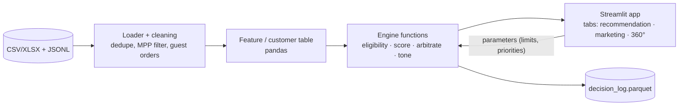
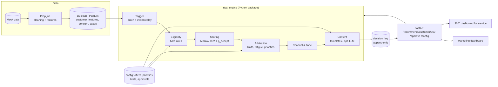
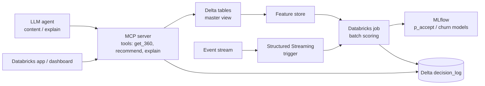

# Planning: MAINGAU Next Best Action Engine
Futury Build Days #3 (AI Edition), 26–27 Oct 2026

**Sources:** `Hackathon_slides_for_MAINGAU.pptx` (13 slides incl. speaker notes). Citations appear as **[Sn]** for slide n. **[Sn-N]** means the speaker notes of slide n. I also reviewed the mock data supplied with the brief (`Re__Präsentation_Hackathon/…`). Statements based on it are marked **[Data: file]**. The data is not part of the presentation; it only makes it more precise.

**Image content:** I looked at every embedded image. They are the MAINGAU logo (S1, S13), an office photo (S3) and icons of the business lines (S4). None of the images carries task content. Diagrams such as the pipeline (S9) and the system landscape (S5) are built from PowerPoint shapes with text and are fully captured by the slide text.

---

## 1. Task

### 1.1 Goal and problem in my own words

MAINGAU has five business lines, and each runs its own system: energy, Autostrom, mobile, online shop and Smart Living [S4, S5]. A unified customer view on Databricks is being built. What is missing is the **decision layer** on top of it, which decides which offer goes out through which channel, in which tone and at what time [S5].

Today campaigns run on broad, product-based segments with static criteria. They are neither personalised nor dynamic, and they ignore customer lifetime value (CLV) [S6]. The biggest gap is cross-selling across the portfolio [S6-N].

**Goal:** a clickable prototype that recommends **offer, channel and tone** per customer, plus a marketing dashboard to steer it [S6]. The "best" action is the one with the **highest expected CLV gain** [S6, S7]:

> E[value of an action] = p(accept) × (CLV after − CLV now) − contact cost [S7]

So the core is not a classic recommender system ("what fits this customer") but a **value-based decision under constraints**. The constraints include consent, exclusions, contact limits and human in the loop [S8, S12]. Every decision must be explainable and logged [S8, S12]. Often a **service action** beats a sales offer [S7].

### 1.2 Requirements

**MUST** (core, identical for every team [S11, S11-N])

| # | Requirement | Source |
|---|---|---|
| M1 | Clickable prototype: per customer offer, channel, tone (Du/Sie), expected CLV gain and reason | S8, S10, S11 |
| M2 | Ranking by expected CLV gain. Negative actions are dropped, fatigue and limits are respected | S7, S9 |
| M3 | Marketing dashboard: top NBAs across customers and segments. Offers, priorities and contact limits can be set. Content, channels and tone can be approved | S10, S11 |
| M4 | Customer 360° dashboard for service: status (products, contracts, open cases), CLV, top-ranked NBAs with reason | S10, S10-N, S11 |
| M5 | Architecture concept on **one** slide: running on Databricks with MCP data access | S10, S11 |
| M6 | Pitch: 8 min plus 4 min Q&A, **in English** | S11, S12 |
| M7 | **One** deep-dive option from A–D | S11 |
| M8 | **Explain:** a marketer understands in one line why the action was chosen, and can change it | S8 |
| M9 | **Learn as a concept:** how do reactions improve the engine, and how is causality shown (control group, uplift)? | S8, S8-N |
| M10 | Hard rules that apply **before** ranking: consent is binding and a withdrawal stops actions at once. Exclusions (dunning, open complaint, cancellation) block sales content | S7-N, S12 |
| M11 | No autonomous sending: the engine proposes, marketing approves | S12 |
| M12 | Personalisation only with profiling consent | S12 |
| M13 | No manipulation: no personalised prices, no artificial urgency, no targeting of customers in hardship | S12 |
| M14 | Payment data only as an exclusion criterion, never for creditworthiness scoring | S12, S12-N |
| M15 | Every decision logged with inputs, rules, scores and chosen action | S8, S12 |
| M16 | Mock data only, no scraping of MAINGAU systems. Customer content in German | S12 |

**SHOULD** (recommended, improves the score)

| # | Requirement | Source |
|---|---|---|
| S1 | Adopt the reference pipeline: Trigger → Eligibility → Scoring → Arbitration → Channel & Tone → Content → Delivery & Log. Changes are allowed | S9, S9-N |
| S2 | Start with rules, precomputed CLV and acceptance rates from the action history | S9 |
| S3 | Keep and maintain a control group | S8, S9 |
| S4 | Cover the four example cases: gas meter deregistration → heat-pump electricity, wallbox purchase → Autostrom, three clicks on the heat-pump story → follow-up, high-value vs. new customer | S6 |
| S5 | Solve the Autostrom example correctly: with 3 failed charging sessions the service fix scores positive and the electricity offer negative | S7 |
| S6 | Channel choice by behaviour: a formally writing customer who never opens newsletters but visits the portal weekly gets a portal pop-up addressed with "Sie" | S9 |
| S7 | Sketch the path to ML | S9-N |

**COULD** (optional)

| # | Option | Source |
|---|---|---|
| K1 | ML models (p_accept, churn, tone). "ML is optional" | S9 |
| K2 | Content generation via LLM within approved templates (= deep dive C) | S9, S11 |
| K3 | Event replay of the 640 live events (= deep dive B). No live event processing in the core | S6-N, S11, S12 |
| K4 | Actually build the feedback loop and uplift (deep dive A) | S8-N, S11 |
| K5 | Tone detection as its own model (deep dive D) | S11 |

**Explicitly not required:** data integration, i.e. "the pipes" [S5, S5-N], live event processing in the core [S6-N] and production interfaces [S6-N].

### 1.3 Given data, interfaces, technologies, deliverable formats

- **Data:** 750 synthetic customers, 16 tables sharing one `customer_id`, 640 live events for replay, 10 % control group in the action history [S12]. CLV, margins, churn drivers and all parameters are precomputed (`customer_value`, `value_assumptions`) [S7].
  - [Data: README] Snapshot of 30 Sep 2026 23:59, event stream of 1 Oct 2026. 150 customers hold only Autostrom. The data contains deliberate traps: Apple MPP machine opens, late roaming CDRs, guest orders, consent withdrawn by unsubscribe, legacy actions without a consent check, offline HEMS gateways and duplicate events (confirmed in S12-N).
  - [Data: clv_method] The exact dCLV formula including the reject branch (see section 3) and notes on one-off products.
- **Target technology:** Databricks (master view) and MCP for data access, but only as an architecture concept [S5, S5-N, S10]. An LLM for content is an option, not a requirement [S9].
- **Interfaces:** there are no live interfaces; the data comes as files [S5, S6-N]. [Data] XLSX, CSV and JSONL are provided.
- **Deliverables:** prototype, marketing dashboard, 360° dashboard, one architecture slide, pitch (8 + 4 min, English) and one deep dive [S11].
- **Time budget:** 32 hours [S6-N].

---

## 2. Judging criteria

### 2.1 Jury weighting [S11]

| Criterion | Weight |
|---|---|
| Technical quality | 25 % |
| Feasibility | 25 % |
| Impact for MAINGAU | 25 % |
| Innovation | 15 % |
| Pitch | 10 % |

**Checked on reference customers hidden in the data** [S11]:
1. Expected CLV gain of the recommended actions
2. **Zero** consent or exclusion violations
3. A clear reason for every decision

### 2.2 Consequences for prioritisation

1. **Correctness before sophistication.** A single consent or exclusion violation on a reference customer is a hard failure, because the requirement says "zero". The eligibility stage is therefore the most important component. It needs unit tests against every known data trap, including unsubscribe as withdrawal, legacy actions with `consent_checked=False` and dunning levels.
2. **The dCLV calculation must follow `clv_method` exactly.** The jury will very likely recompute the "expected CLV gain" with this method. Our own "better" CLV models only make sense as an addition, never as a replacement.
3. **Feasibility (25 %) and technical quality (25 %) together make 50 %.** A clean, traceable pipeline, a decision log and a realistic Databricks path matter more than a complex ML model. S9 says explicitly: rules plus precomputed CLV are enough.
4. **Impact (25 %):** the four examples from S6 and the Autostrom example from S7 should be visibly solved in the demo. Ideally with a metric such as "Σ expected dCLV vs. the legacy rule engine".
5. **Innovation (15 %)** comes mainly from the deep dive and the reasons: one-line, human-readable reasons and a clean uplift concept. A Markov or ML approach contributes here, but must not put point 1 at risk.
6. **Pitch (10 %, English):** fix the demo story early and do not rebuild it on day 2.

**Resulting order:** eligibility, then dCLV scoring, then arbitration and log, then 360° view, then marketing dashboard, then deep dive, then ML refinement.

---

## 3. Approach: Markov chain with ML

### 3.1 The given CLV formula already is a Markov chain

The CLV method [Data: clv_method] reads:

```
CLV = Σ_{t=1..10} (margin − cost_to_serve) · (1 − churn)^(t−1) / 1.06^t
```

This is the expected discounted reward of an **absorbing Markov chain with two states**: `active` moves to the absorbing state `churned` with probability `churn`. It is a **Markov reward process** with a time step of one year, horizon H = 10 and discount factor γ = 1/1.06.

Actions change the parameters of this chain [Data: clv_method]:
- **Accept** (sales/upsell): margin rises by `annual_margin_if_bought`, churn changes by `churn_effect_if_bought`. One-off products count their margin only once.
- **Accept** for retention (P-EN-02): the churn driver "price guarantee ends" is removed.
- **Accept** for service (P-SV-01): the service churn drivers are removed, minus `service_resolution_cost_eur`.
- **Reject:** the chain stays unchanged, **except** for a sales contact during an open complaint or dunning. Then churn rises by 0.05.

```
dCLV = p·(CLV_acc − CLV_now) + (1−p)·(CLV_rej − CLV_now) − contact_cost
```

Formally this is a **one-step lookahead in a Markov decision process (MDP)**. The action acts as a transition in parameter space, and the chain values the consequences. This view is the main argument for the Markov approach, because it connects **seamlessly** to the required valuation.

### 3.2 Proposed Markov modelling on three levels

**Level 1 – value chain (mandatory, exactly as specified)**
- States: {active, churned}. Time step: 1 year. Order: 1. Constant transition probability per scenario.
- Purpose: compute CLV_now, CLV_acc and CLV_rej. The formula is deterministic; no ML is needed here.

**Level 2 – customer state chain (optional extension)**
- State = tuple of (product bundle, service situation, engagement situation), e.g. `({electricity, Autostrom}, open_complaint, portal_active)`.
  - Product bundle: set of active business lines. With 5 lines that is at most 2⁵ = 32 states, in practice far fewer.
  - Service situation: {ok, open ticket, complaint, dunning, cancellation}.
  - Engagement: {inactive, newsletter-active, portal-active, both}.
- Transitions (monthly): product purchase, cancellation, new ticket, ticket resolved.
- Purpose: a more realistic CLV projection, because service cases get resolved and customers buy further products. **Cross-sell paths** also become visible (gas → heat-pump electricity, wallbox → Autostrom [S6]).
- Order: because of fatigue and "three clicks in a row" [S6], order 1 is not enough. I recommend **state augmentation** instead of a higher order, i.e. counters such as `contacts_30d` or `clicks_topic_last_3` as part of the state. This keeps the chain formally at order 1.

**Level 3 – interaction or response chain (for p_accept and deep dive A)**
- States: `delivered → seen (human open, excluding Apple MPP) → clicked → converted` plus `ignored`, `dismissed` and `unsubscribed` (absorbing).
- Transitions are estimated from `nba_action_history` and `newsletter_performance`, per combination of channel, offer and tone.
- Purpose: p_accept as the **absorption probability** into "converted". The unsubscribe risk can also be modelled as a real cost of a contact, which gives a fatigue argument.

### 3.3 Where ML adds value

| Sub-problem | Role of ML | Rationale |
|---|---|---|
| **p_accept** (offer × channel × tone × customer features) | Hierarchical **Beta-Binomial shrinkage** as baseline (S9: "Start with rates from history"). Then **logistic regression** or a small GBM with calibration | Little data (~2,000 non-control actions, ~200 clicks [Data]). Many cells are empty, so shrinkage is needed |
| **Level-2 transition probabilities** | Multinomial logistic regression or a count model per source state, with covariates (discrete-time hazard) | Instead of one global matrix there is a **customer-specific transition matrix**, i.e. a hybrid model |
| **State estimation** of latent intent (e.g. "plans a heat pump", "frustrated") | **Hidden Markov model** over event sequences, or a simple Bayes filter | Derive states that cannot be observed directly from signals: gas meter deregistration, heat-pump clicks [S6], failed charging sessions [S7] |
| **Tone (Du/Sie)** | Rule-based via pronoun counts in `message_text` and `call_transcripts`, optionally a classifier (deep dive D) | [Data: README] tone is not labelled and must be derived |
| **Uplift / causality** | Difference treatment − control per offer × channel, later a T-learner or uplift tree | S8 asks for proof of causality, S12 mentions the 10 % control group |

**Compliance boundary for ML:** personalised models (individual covariates) may only run for customers with `profiling_analytics = granted` [S12]. Everyone else gets **segment or population rates**. Payment data (dunning, `payment_method`) must **not be features** in p_accept or churn models, only exclusions [S12]. *Assumption:* the precomputed churn probability in `customer_value` already includes `dunning_ge2` [Data: value_assumptions]. We take it as given but build no model of our own on payment data.

### 3.4 Limits of the approach

- **Markov property:** customer behaviour depends on history (fatigue, seasonality, end of the price guarantee). State augmentation helps but enlarges the state space.
- **Data volume:** with 750 customers and a few months of history, level-2 transitions are sparse and the estimates become unstable. Remedies: shrinkage towards the population and coarse states.
- **Stationarity:** transitions change over time, e.g. because of the AC price cut on 1 Jul 2026 [Data: sources].
- **Correlation is not causation:** transition rates from the legacy history are biased by the old rule engine (selection bias). Only the comparison with the control group yields causal effects [S8].
- **Consistency with the jury's valuation:** a CLV model of our own (level 2) produces different numbers than `clv_method`. We therefore show the specified CLV as the primary value and level 2 at most as an additional view.
- **Explainability:** an HMM or GBM is harder to explain in one line [S8]. Reasons should therefore be generated from rules and drivers, not from model internals.

### 3.5 Alternatives for comparison

| Alternative | Strength | Weakness in this context |
|---|---|---|
| Purely rule-based plus specified CLV (S9 "Day one") | Fast, fully explainable, covers the judging | Little innovation |
| Contextual bandit (Thompson sampling on p_accept) | Natural "Learn" loop [S8], exploration | Needs online feedback, can only be simulated in the hackathon |
| Uplift model (T-/X-learner) | Directly causal, fits S8 | Few control observations (248 [Data]) |
| Survival model (Cox, discrete-time hazard) for churn | Statistically cleaner than constant churn | Deviates from the specified CLV |
| Full MDP / reinforcement learning (multi-step policy) | Plans sequences such as "service fix first, then offer" | Too much for 32 h, hard to validate and explain |

**Recommendation:** implement level 1 exactly (the core). Level 3 plus Beta-Binomial shrinkage for p_accept (light ML). Level 2 and the HMM only as a concept or slide in the "Learn" part. This way the Markov framing carries the story ("we model the customer as a Markov reward process, and every NBA shifts its transitions") without putting the mandatory valuation at risk.

### 3.6 Open modelling questions (to settle before starting)

1. Time step: level 1 is yearly (as specified). Are levels 2 and 3 monthly or event-based?
2. What counts as "accept"? `clicked`, `converted_within_14d` or conversion value > 0? This directly affects p_accept.
3. How is p_accept estimated for **service actions** (P-SV-01)? They do not seem to appear as offers in the history; `service_nba_feedback` has its own reactions. *Assumption needed.*
4. Should the churn drivers in `customer_value.churn_drivers` be decomposed directly (additive according to `value_assumptions`) to compute CLV_acc for retention and service? How is the floor of the `multi_line_factor` (min. 0.5×) applied to product purchases?
5. Are several NBAs per customer and period allowed (a sequence), or exactly one?
6. How is fatigue quantified: as a hard limit or as a cost term in the score? The slides give no values.

---

## 4. System design: proposals

All variants implement the reference pipeline from S9:

```
Trigger → Eligibility → Scoring → Arbitration → Channel&Tone → Content → Delivery&Log
                                                                            │
                         └──────────── Feedback (Response) ─────────────────┘
```

### Variant A – monolith: Python notebook/script plus Streamlit



- **Pros:** fastest (~6–8 h to a first demo), one repo, one language, little integration risk.
- **Cons:** engine and UI are entangled. That weakens the feasibility story for Databricks and MCP, and the approval workflow and logging quickly become ad hoc.
- **Risks:** Streamlit state with several users. Performance is uncritical with 750 customers.
- **Effort:** low.

### Variant B – engine as a library plus API, separate UIs (recommended)



- **Interfaces:**
  - `recommend(customer_id | segment) → [Decision]`, where a decision contains offer, channel, tone, dCLV, reason, rule trace and decision ID.
  - `customer_360(id)` returns status, CLV and the top NBAs.
  - `config GET/PUT` and `approve(decision_id | template_id)`.
- **Pros:** clean separation along S9. The engine is testable, especially eligibility against the traps. The API maps 1:1 to later **MCP tools** (architecture slide). The log is central (S12).
- **Cons:** more boilerplate, two frontends. Built as one Streamlit multipage app, this stays manageable.
- **Risks:** integration effort between API and UI. Remedy: the UI first calls the engine directly as a package; the API follows later as a thin layer.
- **Effort:** medium (~12–16 h for the core).

### Variant C – "Databricks-native" plus MCP server plus LLM agent



- **Pros:** highest innovation and target-picture value, directly compatible with MAINGAU [S5, S10].
- **Cons:** high setup hurdle. It is unclear whether a Databricks workspace is available. Error-prone, and the LLM makes the "zero violations" guarantee harder.
- **Risks:** infrastructure eats the time needed for the core logic. Without a workspace it cannot be demonstrated.
- **Effort:** high.

### Recommendation

**Build variant B, show variant C as the architecture slide.**

- B meets M1–M4 as well as M8, M11 and M15 structurally: the pipeline stages match S9, approval and configuration have their own endpoints, and the log is append-only.
- Feasibility and technical quality (50 %) benefit from testability and clear separation.
- On the architecture slide the engine API becomes MCP tools on Databricks (M5). That gives a credible migration story without infrastructure risk.
- Fallback: if time runs short, B becomes A without the API (the UI imports the package directly). The engine logic stays unchanged.

**Deep-dive recommendation:** **A – feedback loop & uplift.** It fits the Markov and ML approach best (level 3, Beta-Binomial update as Bayesian learning, control-group comparison), and the control group exists in the data [S12]. Alternative: D (tone) if a team member has NLP experience.

---

## 5. Algorithms and data structures

Notation: C = customers (750), O = offers (18 in the catalogue [Data]), K = channels (5 in the history [Data]), T = tones (2), R = rules.

### 5.1 Data prep and traps

| Sub-problem | Algorithm | Complexity | Rationale |
|---|---|---|---|
| Duplicate events (12 duplicates in 647 lines [Data]) | Hash set over `event_id` | O(n) | Idempotent processing |
| Late roaming CDRs | Sort by `occurred_at`, watermark on `ingested_at`, counting windows always by `occurred_at` | O(n log n) | Count "3 failed charging sessions in 30 days" correctly |
| Apple MPP opens | Filter `open_client_class == apple_mpp_prefetch` | O(n) | Otherwise engagement is overestimated |
| Guest orders | Drop or leave unassigned where `customer_id IS NULL` | O(n) | No false triggers |
| Consent status | Latest status per (customer, type). Unsubscribe events set `withdrawn` | O(n log n), or O(n) with a dict | Withdrawal applies at once [S12] |

### 5.2 Eligibility

- **Algorithm:** rule cascade with short-circuit, per candidate (customer, offer, channel). Order: consent per channel → profiling consent (otherwise only non-personalised defaults) → exclusions (dunning ≥ 1, open complaint, cancellation block sales [S12]) → product already held → frequency and fatigue.
- **Complexity:** O(C · O · K · R), in practice under 10⁶ operations and thus trivial.
- **Data structure:** rules as a **list of predicate objects** (id, description, function). Each check writes into a `rule_trace` that feeds the decision log and the reason text directly. Optional: consent per customer as a **bitmask** over the 6 consent types, so the channel check costs O(1).

### 5.3 Scoring (Markov CLV)

- **CLV in closed form** instead of a loop, with q = 1 − churn and γ = 1/1.06:
  `CLV = m·γ · (1 − (qγ)^H) / (1 − qγ)`, i.e. O(1) per scenario. One-off products are added, not annuitised.
- Three scenarios per candidate (now, acc, rej), O(C · O · K · T) in total.
- **Churn decomposition:** base churn × multi-line factor plus additive drivers [Data: value_assumptions]. They are kept as a **dict `driver → delta`** per customer, so retention and service can remove specific drivers.
- **Level 2 (optional):** small **dense transition matrix** (numpy, k ≤ ~50 states). Absorbing chain: fundamental matrix N = (I − Q)⁻¹ with O(k³) ≈ 10⁵ operations, negligible. Discounted value V = (I − γP)⁻¹ r. For finite horizons iteratively, O(H · k²).
- For a large state space (level-3 sequences, many events), a **dict of Counters** (`counts[s][s'] += 1`) for learning and **scipy.sparse CSR** for computing are suitable, because most transitions never occur.

### 5.4 p_accept

- **Baseline:** hierarchical Beta-Binomial shrinkage.
  `p(o,k,t) = (succ + α · p(o,k)) / (n + α)`, where p(o,k) is in turn shrunk towards p(o) and then towards p_global.
  Aggregation in O(N) over the history. Lookup in O(1) via a **dict with tuple keys** `(offer, channel, tone)`.
- The control group (`held_out`) is **not** in the denominator; it serves as the uplift baseline.
- Mark or exclude legacy actions with `consent_checked=False` during learning. *Assumption:* they are biased and legally problematic.
- **ML stage:** logistic regression (O(N · d · iterations)) with Platt or isotonic calibration, only for customers with profiling consent.
- **Learn loop (deep dive A):** Beta posterior update per response in O(1). Optionally Thompson sampling for exploration.

### 5.5 Arbitration

- **Per customer:** drop dCLV ≤ 0, then top-1 or top-k via a **heap** in O(O·K·T · log k).
- **Global contact limits** (e.g. outbound calls per day, contacts per customer and month): **greedy over a priority queue** by dCLV (or dCLV per unit of capacity), O(M log M) with M candidates. Hard budgets would need an exact ILP or knapsack; for the hackathon greedy is enough (≥ ½-approximation for simple capacities). This is documented as an assumption.
- **Marketing priorities** as weights or boosts in the config dict. They are logged so it stays traceable why the ranking deviates from pure dCLV.

### 5.6 Channel & Tone

- **Channel:** it already enters scoring as a dimension (p_accept and contact cost per channel). On top of that comes engagement affinity (portal sessions per week, human open rate), see the example in S9.
- **Tone:**
  1. Form of address chosen explicitly in customer texts: regex counts of Du and Sie forms in `message_text` and `call_transcripts`, O(text length).
  2. If there is no text: default "Sie". *Assumption* (conservative, as in 1,698 of 2,270 legacy actions [Data]).
  3. Optional (deep dive D): classifier with TF-IDF and logistic regression.

### 5.7 Content, log, explain

- **Content:** template lookup `dict[(offer, tone)] → template`, only approved templates (status flag). An LLM only for variants within the templates [S9]. A post-check for forbidden patterns (urgency, prices) implements S12.
- **Decision log:** append-only **Parquet or DuckDB table** with `decision_id, ts, customer_id, inputs_snapshot (JSON), rule_trace (JSON), scores, chosen, reason, status (proposed/approved/rejected), control_group_flag`.
- **Reason generation:** template from the dominant driver, e.g. "3 failed charges in 30 d → service fix: +€X CLV; sales offer blocked (−€Y)". Costs O(1) and is deterministic.
- **Caches:**
  - precomputed `customer_features` table (one pass, O(Σ rows))
  - `functools.lru_cache` or a session cache for the 360° view
  - cache of candidate scores per config version, invalidated on config change

### 5.8 Uplift / causality (Learn)

- Difference of conversion rates treatment − control per (offer, channel), confidence interval via **bootstrap** in O(B · n). Alternatively a two-proportion z-test.
- Further: T-learner with two classifiers and a Qini curve for evaluation.

### Pseudocode sketch of the pipeline (for illustration only)

```
for customer in trigger_set:
    cands = [(o,k,t) for o in offers for k in channels for t in tones]
    cands = [c for c in cands if eligible(customer, c, trace)]    # hard rules
    for c in cands:
        c.dclv = p_accept(c)·ΔCLV_acc + (1−p)·ΔCLV_rej − cost(c.k)
    best = top_k(filter(c.dclv > 0), respecting limits)          # otherwise: "no action"
    log(customer, inputs, trace, scores, best, reason(best))     # status = proposed
```

---

## 6. Open questions and assumptions

### 6.1 Open questions (missing or unclear in the presentation)

1. **Reference customers:** which customers are they, and how exactly are they assessed [S11]? Is there a submission format, e.g. a CSV with recommendations per customer, or does the jury assess live on the prototype?
2. **Number of tables:** S12 says 16 tables, the README 15 source tables, the CSV folder contains 21 files (incl. `columns`, `sources`, `value_assumptions` etc.). Which ones count?
3. **Number of events:** S12 says 640 live events. The JSONL has 647 lines with 12 duplicates, i.e. 635 unique [Data]. Is the difference intended?
4. **Contact limits and fatigue:** the slides give no concrete values [S8, S9, S10]. Neither does `value_assumptions`. Should we set them ourselves (as a marketing setting)?
5. **Cancellation and retention:** "Cancellations block sales content" [S12]. Is the retention offer P-EN-02 allowed after a received cancellation (win-back) or blocked as well?
6. **Profiling consent:** what may be shown without `profiling_analytics` [S12]? Only non-personalised standard actions? Is using the individual CLV already profiling?
7. **"Targeting of customers in hardship"** [S12]: how is hardship detected in the data? Only via the dunning level, or via further signals such as instalment plans or ticket texts?
8. **Tone:** is "tone" only Du/Sie [S8], or are style nuances meant too (formal/casual, factual/emotional)?
9. **Channels:** which channels may the engine use? Does a service agent in conversation (360° view) count as a channel of its own?
10. **Databricks and MCP:** is there access to a workspace, or is this purely conceptual [S10]? Which MCP server or tool interface is meant?
11. **LLM use:** may external LLM APIs be used with (synthetic) customer data? Are there requirements on the model?
12. **Submission:** repo link, video, hosted demo? Deadline on 27 Oct? Team size? The note "Shared on [DATUM]" on S13 is an unfilled placeholder.
13. **Time frame of the recommendation:** does the NBA refer to the snapshot of 30 Sep (batch) or to each event time on 1 Oct (replay)?
14. **Several actions:** one NBA per customer, or a ranking with several actions allowed at the same time (e.g. service fix and later upsell)?
15. **Definition of "accept"** for p_accept: click, conversion within 14 days, or a positive agent reaction?

### 6.2 Assumptions made

- **ASSUMPTION A1:** Judging uses the dCLV formula from `clv_method`. Our primary score follows it exactly.
- **ASSUMPTION A2:** p_accept means `converted_within_14d = True`. Clicks serve only as a prior or a weaker signal.
- **ASSUMPTION A3:** Control records (`held_out`) do not enter p_accept, only the uplift analysis.
- **ASSUMPTION A4:** Actions with `consent_checked=False` are excluded from learning and shown as a compliance finding in the analysis.
- **ASSUMPTION A5:** Tone means only Du/Sie. The default is "Sie" when there is no text signal.
- **ASSUMPTION A6:** Contact limits are marketing parameters with starting values we set (e.g. at most 1 sales contact per customer and week, at most N outbound calls per day). They can be changed in the dashboard.
- **ASSUMPTION A7:** Without profiling consent the customer only gets actions based on population or segment p_accept that use no individual behavioural analysis. Service actions stay allowed.
- **ASSUMPTION A8:** Dunning level ≥ 1, an open complaint or a received cancellation block all sales and upsell offers. Service actions stay allowed; retention only once question 5 is clarified.
- **ASSUMPTION A9:** If no action has dCLV > 0, "no action" is a valid, logged decision.
- **ASSUMPTION A10:** No Databricks access. Databricks and MCP appear only on the architecture slide.
- **ASSUMPTION A11:** The prototype processes batch data as of the snapshot of 30 Sep. Event replay is optional (deep dive B) and not part of the core. However, eligibility-relevant events (consent change, dunning, cancellation, complaint, gas meter deregistration) are already applied as soon as they have been *ingested* by `as_of`.
- **ASSUMPTION A12:** Every outbound channel needs its consent, also for service actions: `newsletter_email` → newsletter_email, `email` → marketing_email, `sms` → marketing_sms, `outbound_call` → marketing_phone, `portal_popup`/`app_push` → portal_app_personalisation. This is conservative and protects "zero violations". An unsubscribe withdraws only `newsletter_email`.
- **ASSUMPTION A13:** A cancelled Autostrom contract counts as "cancellation received" and blocks sales. Retention after a cancellation can be switched on via `EngineConfig.allow_retention_on_cancellation` (default: blocked, question 5).
- **ASSUMPTION A14:** Starting value for the contact limit: at most 4 delivered sales contacts per customer in 30 days (makes A6 concrete).
- **ASSUMPTION A15:** According to `clv_method`, the reject penalty (+0.05 churn) applies during an open complaint or dunning. S7 speaks more generally of an "open service case". By default every open ticket therefore counts (`reject_penalty_on_any_open_ticket`). Only then does the S7 example MG-100009 (charging ticket on 1 Oct) score negative.
- **ASSUMPTION A16:** A service fix removes the drivers open complaint, tickets ≥ 2, low CSAT and failed charging sessions, but **not** the dunning driver. Otherwise payment data would create value (S12).
- **ASSUMPTION A17:** There is no history for P-SV-01. Prior p_accept = 0.5, changeable in the dashboard. One-off products add their margin once and undiscounted. `app_push` costs the same as a portal pop-up (€0).
- **ASSUMPTION A18:** p_accept uses only population or segment rates (offer × channel × tone) and is therefore allowed without profiling consent. The shrinkage strength is 30 pseudo-observations per level.
- **ASSUMPTION A19:** Each customer gets at most one action per run. Outbound call capacity is 25 per run (call-centre limit, changeable in the dashboard). Marketing priorities only weight the ranking; the condition dCLV > 0 still holds.
- **ASSUMPTION A20:** 10 % of sales decisions go into the control group via a stable hash (status `held_out`, not sent). Service actions are never held out, because a customer with a problem should not lose the fix because of an experiment.
- **ASSUMPTION A21:** A trigger signal counts as purchase intent, like a click. With signal strength s, p_accept is moved towards the offer's "conversion after click" rate: `p = p_base + s·(p_intent − p_base)`. p_intent is a second Beta-Binomial model fitted only on clicked actions (history: 31 % after a click vs. 3.4 % overall). Strengths: gas meter deregistration, 3 heat-pump clicks and wallbox 1.0 each, heat pump in HEMS 0.5. Only the strongest signal per offer counts. p is capped at 0.5. Rationale: the old P-AS-01 actions went out untargeted (0/179 conversions), so their base rate is no yardstick for customers with a signal.
- **ASSUMPTION A22:** Signals, channel affinity and the detected Du/Sie form of address are personalisation and apply only with `profiling_analytics`. Without consent, population rates apply, the form of address is "Sie", and the signal is logged as "not used".
- **ASSUMPTION A23:** Channel affinity compares human opens of the last 6 newsletters (excluding Apple MPP) and portal and app visits per week (Jul–Sep) with the population average, smoothed with 2 pseudo-observations and bounded to ×0.1 to ×3 of the odds.
- **ASSUMPTION A24:** Marketing approval of channels and tone (S10) is a config switch. A channel that is not approved is skipped in arbitration (logged as a note). If "Du" is not approved, every customer gets "Sie" and the tone evidence records the override. Approval of individual actions happens in the decision log (proposed → approved/rejected).
- **ASSUMPTION A25:** Segments in the dashboard are CLV terciles (low/mid/high value). Customers younger than 365 days form their own segment "New customer". This makes the "high-value vs. new customer" comparison from S6 visible.

---

## Appendix: rough schedule (32 h, proposal)

| Block | Content | Result |
|---|---|---|
| 0–2 h | Clarify questions 6.1 with the mentor, assign roles, repo skeleton | Decisions fixed |
| 2–8 h | Data prep and traps, eligibility with tests | Eligibility green |
| 8–14 h | Markov CLV scoring, p_accept shrinkage, arbitration, log | Engine delivers a ranking |
| 14–20 h | 360° dashboard and marketing dashboard (config, approve) | Clickable prototype |
| 20–26 h | Deep dive A (uplift, learn loop), sharpen reason texts | Differentiation |
| 26–30 h | Architecture slide (Databricks/MCP), demo story around the S6/S7 examples | Pitch material |
| 30–32 h | Practice pitch in English, buffer | Submission |
